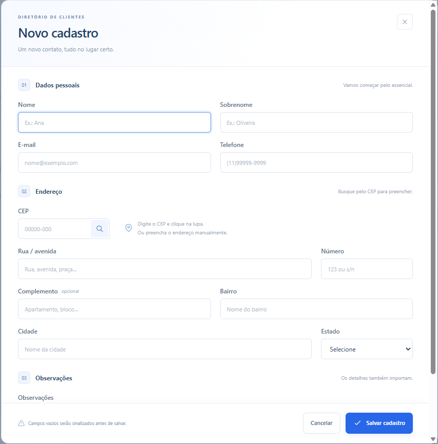
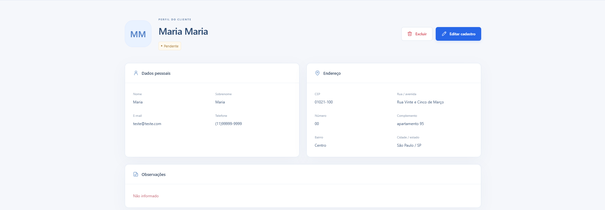
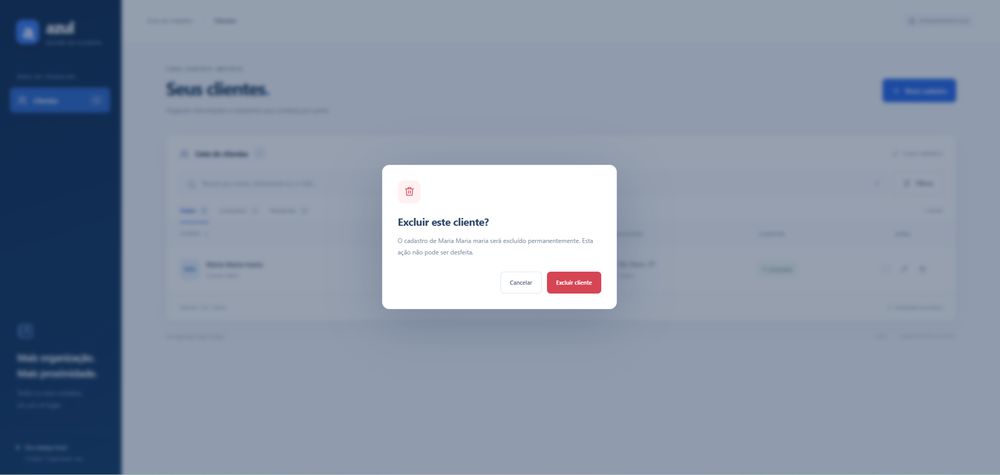
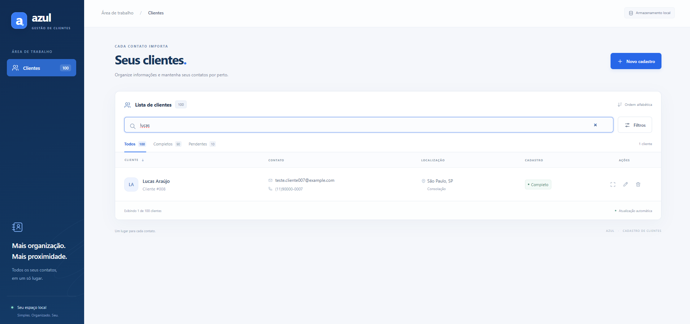
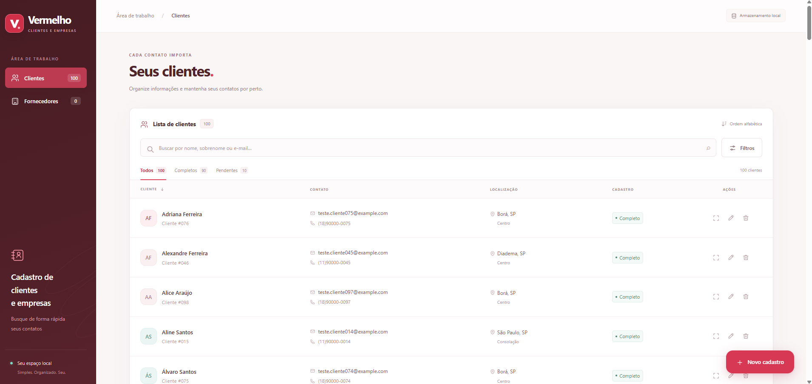
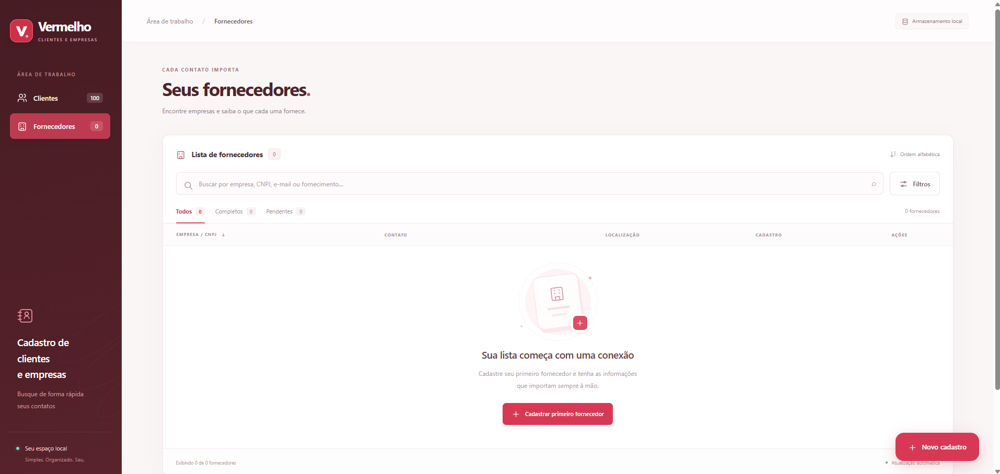

# Cadastro básico de clientes 

Projeto demonstrativo desenvolvido como **experimento de programação assistida por IA**, com foco na criação e evolução de um sistema a partir de **prompts (instruções em linguagem natural)**. A ideia inicial era produzir um cadastro básico de clientes, testar o resultado e permitir melhorias e novas funcionalidades em etapas posteriores.

As imagens abaixo documentam a evolução: da primeira interface azul, com cadastro e consultas de clientes, à versão vermelha, que passou a contar também com cadastro de fornecedores. O objetivo é demonstrar o processo de especificação, testes, ajustes e evolução do software — não representar um sistema comercial em produção.

## Como instalar e abrir no Windows

**Você precisa de:** [Python 3.10 ou superior](https://www.python.org/downloads/) e um navegador (Chrome, Edge ou Firefox). Se ainda não tiver Python, instale-o primeiro e marque a opção **Add Python to PATH**, se disponível. É necessária conexão com a internet para instalar as bibliotecas.

1. Clique em **Code → Download ZIP** nesta página do GitHub. Extraia o arquivo ZIP em uma pasta de sua preferência.
2. Abra a pasta extraída até encontrar o arquivo **`app.py`**.
3. Clique na **barra de endereço do Explorador de Arquivos** (onde aparece o caminho da pasta), digite **`powershell`** e pressione **Enter**. O PowerShell será aberto diretamente na pasta correta.
4. Copie e execute os comandos abaixo **um de cada vez**:

```powershell
python -m venv .venv
.\.venv\Scripts\python.exe -m pip install -r requirements.txt
.\.venv\Scripts\python.exe app.py
```

5. Com o servidor em execução, **copie e cole o endereço abaixo na barra do navegador**, ou clique nele:

**[http://127.0.0.1:8000](http://127.0.0.1:8000)**

> **Importante:** mantenha o PowerShell aberto enquanto usa o sistema. Para encerrar, pressione **Ctrl+C**. Para abrir novamente em outro momento, volte à pasta do projeto, abra o PowerShell pelo mesmo procedimento e execute apenas `.\.venv\Scripts\python.exe app.py`. O sistema salva os cadastros localmente em SQLite.

Se `python` não for reconhecido, verifique a instalação do Python e a configuração do PATH. Se a porta 8000 estiver ocupada, execute `$env:PORT = "8001"` antes de iniciar `app.py` e abra `http://127.0.0.1:8001`.

## Evolução do projeto em imagens

### 1. Versão inicial — interface azul

A primeira etapa concentrou-se nas operações básicas de cadastro, consulta e manutenção de clientes.

**Tela inicial**


**Formulário de novo cadastro**



**Listagem de clientes**


**Perfil do cliente**



**Clientes cadastrados e exclusão com confirmação**




**Teste de busca com 100 registros**



### 2. Evolução — interface vermelha

A segunda etapa alterou a identidade visual e ampliou o cadastro para incluir fornecedores, mantendo os clientes em uma área separada.

**Primeira alteração visual**



**Nova seção de empresas e fornecedores**



**Cadastro de fornecedores**


Prompts usados durante a criação do sistema:

 [Clique aqui para visualizar os prompts utilizados](prompts.txt)
